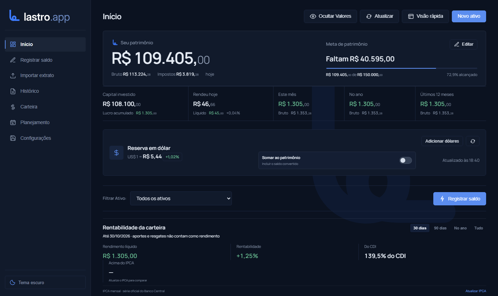
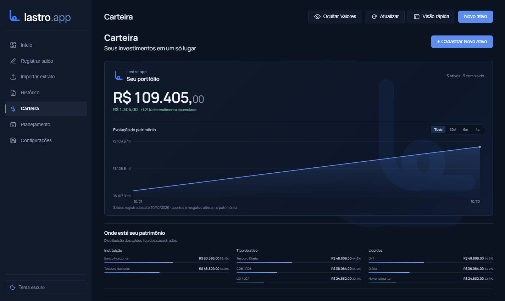

<p align="center">
  
</p>

# Lastro.app

Aplicativo desktop para registrar saldos, acompanhar rendimentos e organizar uma carteira de investimentos. A versão Windows abre em uma janela própria do aplicativo, sem exigir Chrome ou outro navegador.

> **Seus dados ficam no seu computador.** A carteira é armazenada em um banco SQLite local e não é enviada ao GitHub.

## Capturas do aplicativo

As capturas abaixo usam dados fictícios de demonstração.





## Baixar para Windows

Baixe **Lastro.app Setup 1.0.4.exe** na seção **Releases**, execute o instalador e escolha a pasta de instalação. Ele cria atalhos no Menu Iniciar e na Área de Trabalho.

O instalador abre uma janela desktop do Lastro.app; o usuário não precisa abrir Chrome ou outro navegador. O servidor local só atende o próprio aplicativo e é encerrado quando a janela é fechada.

## Seus dados e privacidade

O app salva a carteira em `%APPDATA%\controle-rendimentos-investimentos\rendimentos.db` no Windows. Atualizar o aplicativo preserva esse banco. Faça backups em **Backup e Configurações** para proteger seus dados.

Os dados de demonstração exibidos nas imagens deste README são fictícios e não estão no banco do aplicativo.

## Recursos

- Registro de saldos e histórico de aplicações, aportes, resgates, juros, dividendos, taxas e impostos.
- Visão da carteira por instituição, tipo de ativo e liquidez, com alertas de vencimento e saldos desatualizados.
- Planejamento de juros e dividendos e simulação com taxas e contribuições informadas pelo usuário.
- Backup e restauração de saldos, movimentações, ativos, agenda e série de IPCA guardada localmente.
- Atualização automática da taxa CDI anualizada pelo Banco Central (série SGS 4389), com data de referência visível e uso do último valor salvo quando estiver sem internet.
- Atualização do IPCA sob demanda, com conexão à internet. Como o IPCA é mensal, o retorno real usa uma estimativa proporcional aos dias do período.

A taxa de referência vem da [série SGS 4389 do Banco Central](https://api.bcb.gov.br/dados/serie/bcdata.sgs.4389/dados/ultimos/1?formato=json), anualizada em base de 252 dias úteis. O app atualiza o valor ao consultar o painel, no máximo uma vez a cada seis horas, e guarda a última taxa e sua data no banco local.

As projeções dependem dos valores informados e não representam promessa de rentabilidade.

## Executar pelo código-fonte

Requisitos: Windows e Node.js 22.5 ou superior.

```powershell
npm install
npm start
```

Para abrir a versão web local de desenvolvimento:

```powershell
npm run start:web
```

Depois acesse `http://localhost:3000`. Essa opção usa `data/rendimentos.db`; o arquivo é local e ignorado pelo Git. O aplicativo Windows não precisa dessa etapa.

## Gerar o instalador Windows

```powershell
npm install
npm run dist
```

O instalador NSIS é gerado em `dist/`. Para publicar a versão 1.0.4, crie a tag `v1.0.4` no GitHub e anexe `dist/Lastro.app Setup 1.0.4.exe` à **GitHub Release**. Não adicione o instalador ao histórico Git; publique-o como anexo da Release. O código-fonte e o `package-lock.json` permitem reproduzir a build.

O instalador desta versão não tem assinatura digital. Por isso, o Windows ou um antivírus pode exibir um aviso de reputação ou uma detecção heurística. O aplicativo desktop não inicia PowerShell nem CMD. Caso um antivírus sinalize o instalador, envie o arquivo ao fornecedor para análise; não há como garantir que todo antivírus classifique um executável sem assinatura da mesma forma.

## Capturas do README

Para recriar as imagens com dados fictícios, execute:

```powershell
npm run screenshots
```

O comando salva as capturas em `docs/screenshots/` e usa um banco temporário em memória. Requer Google Chrome instalado.

## Estrutura

- `desktop/`: janela Electron, processo principal e ponte segura com a interface.
- `public/`: interface, estilos, ícones necessários, manifesto PWA, service worker e logos usados na interface.
- `scripts/tests/`: scripts de verificação usados durante o desenvolvimento.
- `scripts/capture-readme.mjs`: recria as capturas do README com dados fictícios.
- `docs/screenshots/`: capturas de tela sem dados pessoais.
- `server.js`: servidor local e acesso ao banco SQLite.

## Licença

MIT. Consulte `LICENSE`.
